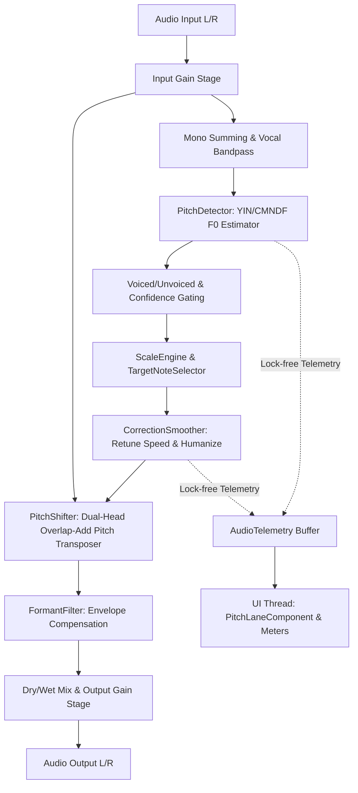

# ToyTune — Architecture Specification
**Developer:** Producer Toy  
**Product:** ToyTune Real-Time Vocal Pitch Correction Plugin  
**Framework:** JUCE 8 (C++17) & CMake  

---

## 1. High-Level System Architecture

---

## 2. Core Subsystems & Components

### 2.1 Audio Processing Pipeline (`ToyTuneAudioProcessor`)
- **Lifecycle:**
  - `prepareToPlay(sampleRate, samplesPerBlock)`: Prepares all delay lines, window tables, filter states, and downsampler buffers.
  - `processBlock(buffer, midiMessages)`: Hard real-time audio thread. No allocations, no mutexes, bounded operations per block.
  - `releaseResources()`: Releases state safely.
- **Latency Handling:**
  - Pitch detection analysis window and overlap-add pitch shifter introduce deterministic algorithmic latency (~10-15 ms).
  - Latency is accurately reported to the host DAW via `setLatencySamples()` for automatic plugin delay compensation (PDC).
  - Low-Latency mode reduces the detector buffer size for live tracking monitoring.

### 2.2 Pitch Detection (`PitchDetector`)
- **Algorithm:**
  - Downsampled pre-filtering with vocal bandpass (default 65 Hz – 1100 Hz).
  - Cumulative Mean Normalized Difference Function (CMNDF):
    $$d'_t(\tau) = \begin{cases} 1 & \text{if } \tau = 0 \\ \frac{d_t(\tau)}{\frac{1}{\tau}\sum_{j=1}^\tau d_t(j)} & \text{otherwise} \end{cases}$$
  - Parabolic interpolation around the first local minimum below the dip threshold (typically 0.15–0.20):
    $$\tau_{\text{peak}} = \tau + \frac{\alpha - \gamma}{2(\alpha - 2\beta + \gamma)}$$
  - Frequency calculation: $F_0 = \frac{f_s}{\tau_{\text{peak}}}$.
  - Voiced/Unvoiced gating: Signals below RMS threshold (-55 dB) or above CMNDF minimum threshold are classified as unvoiced, suppressing false triggers.
  - Octave-jump suppression: Compares candidate period with the previous frame's period to prevent 1-octave harmonic doubling/halving.

### 2.3 Musical Scale & Target Selection (`ScaleEngine`, `TargetNoteSelector`)
- **Scale Definitions:**
  - Bitmask representation of the 12 chromatic semitones (0 = C, 1 = C#, ..., 11 = B).
  - Presets for Chromatic, Major (W-W-H-W-W-W-H), Natural Minor, Harmonic Minor, Melodic Minor, Pentatonic Major/Minor, Blues.
  - Custom note masking allows individual notes to be toggled on/off.
- **Pitch to Note Mapping:**
  - MIDI fractional note: $m = 69 + 12 \log_2(F_0 / A_{\text{ref}})$, where $A_{\text{ref}}$ is reference tuning (440 Hz default).
  - Target note search finds the closest active scale note within allowable tolerance.
  - Calculates target frequency $F_{\text{target}}$ and pitch deviation in cents:
    $$\Delta c = 100 \times (m_{\text{target}} - m)$$

### 2.4 Correction Smoothing (`CorrectionSmoother`)
- **Parameters:**
  - `Retune Speed` (0 to 400 ms): Controls exponential smoothing rate $\alpha = 1 - e^{-\Delta t / \tau_{\text{retune}}}$. At 0 ms, $\alpha = 1$ (hard snap).
  - `Humanize` (0 to 100%): Permits micro-deviations ($\pm 10-25$ cents) around target notes so natural vocal vibrato is preserved while correcting drift.
  - `Flex Tune` (0 to 100%): Soft deadband window preventing correction from pulling notes that are only passing through.
  - `Strength` (0 to 100%): Scales final pitch shift amount:
    $$\text{Ratio} = 2^{(\text{shift\_cents} \times \text{Strength}) / 1200}$$
- **Modes:**
  - `Natural`: Soft retune transition, high vibrato preservation.
  - `Modern`: Crisp commercial pop retune curve.
  - `Hard Tune`: Instant snap (0 ms effective retune, rigid pitch quantization).
  - `Robot`: Fixed pitch quantizer with harmonic anchor.

### 2.5 Real-Time Pitch Shifter (`PitchShifter`)
- **Algorithm:**
  - High-fidelity dual-read head circular delay buffer with dynamic pitch transposition ratio $R = F_{\text{target}} / F_0$.
  - Triangular/Hann cross-fading window prevents clicks at buffer wrap-around boundaries.
  - Cubic Hermite or 4-point Lagrangian fractional sample interpolation for smooth, alias-free audio reconstruction.
  - Stereo phase linkage: Detection is performed on the sum/left channel; both left and right delay lines are modulated with the identical pitch ratio to preserve the stereo image.

### 2.6 Formant Processing (`FormantFilter`)
- Pitch shifting alone causes unnatural spectral shifts (the "chipmunk" or "Darth Vader" effect).
- A 2-pole resonant biquad and dynamic tilt filter compensates for the spectral envelope displacement by scaling formant peaks back toward the original vocal acoustic signature.

### 2.7 UI & Telemetry Architecture (`ToyTuneAudioProcessorEditor`)
- **Thread Safety:**
  - Audio thread writes telemetry (detected F0, target pitch, cents error, RMS input, RMS output) to an atomic state structure.
  - UI thread runs a 30/60 Hz `Timer` polling atomic variables and drawing onto a GPU-accelerated path/buffered canvas.
- **Custom LookAndFeel & Monochrome Theme:**
  - Dark luxury charcoal palette (`#0d0d0f`, `#161619`, `#222226`).
  - Subtle rotary knobs with brushed silver indicators, pearl white typography, and clean numeric readouts.
  - Interactive pitch lane displaying detected pitch trace, target pitch grid, and deviation cents.
